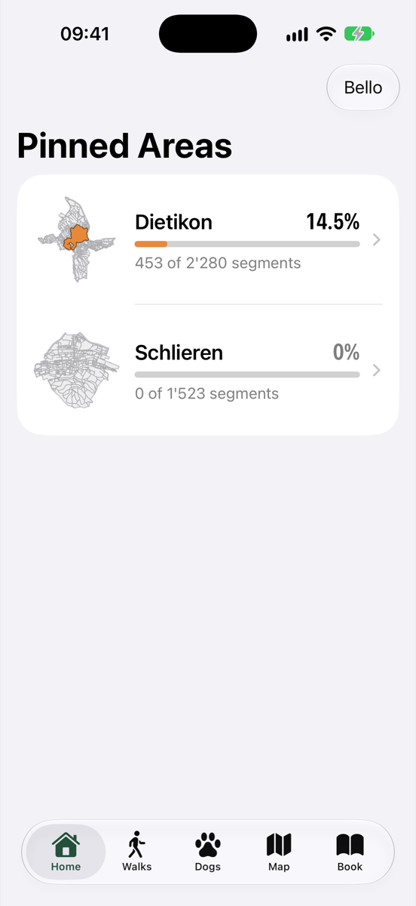
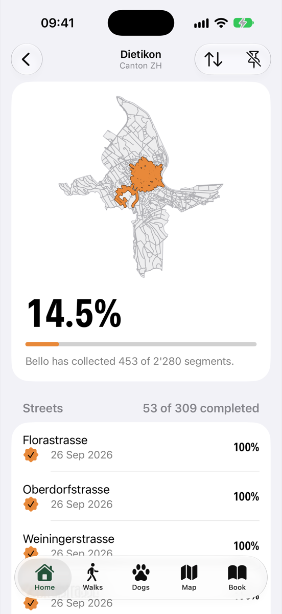
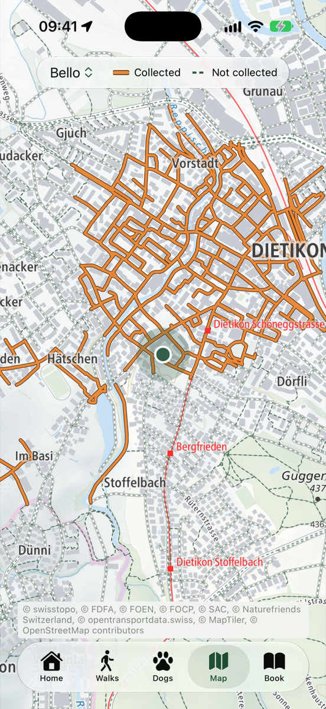
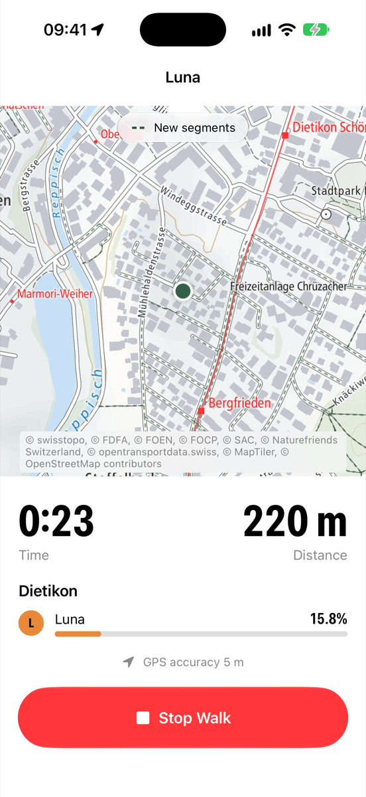
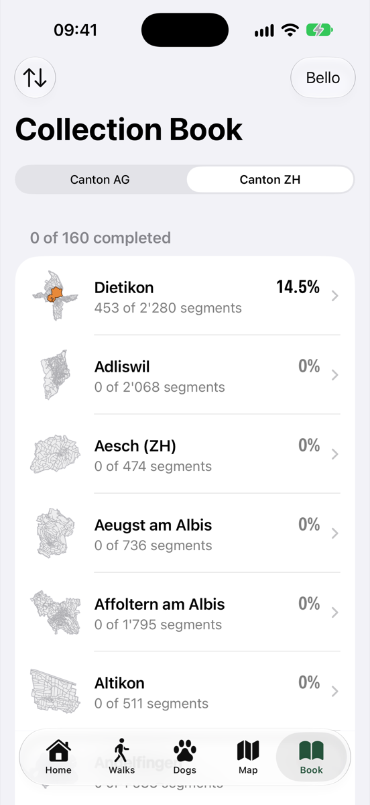
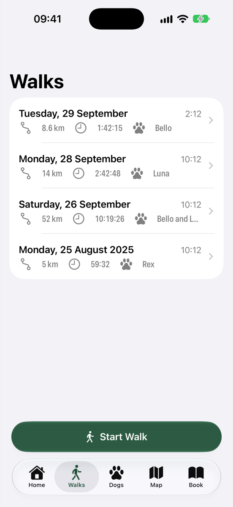

  

<h1 align="center">GassiPass</h1>

  A passport for your dog's walks in Switzerland. 
  Every walk brings your dog closer to its next stamp: in the rings around home, in new streets and Gemeinden, and through its weekly goals.

  
  
  

  
  
  
  

## How it works

The map of Switzerland is cut into **segments**. A segment is a stretch of walkable way between two junctions, or between a junction and a dead end. When a dog's walks cover nearly all of a segment, the dog **collects** it. The walks do not need to cover it in one go. Each dog has its own collection. When two dogs go on the same walk, both collect the segments.

What a dog reaches goes into its **passport** as a **stamp**, with the date. A stamp stays for good. Every walk brings the dog closer to a stamp, on one of three scales:

- **Near home.** The pack has a **home base**, and **rings** around it. Ring 1 has a radius of 250 m, and each next ring is 1.4 times as large. When the dog has collected 95% of a ring, it gets the ring stamp, and the next ring appears. Each walk also leaves **marks** on the segments that it covers, and the map shows where the dog walked most often in the last four weeks.
- **Away from home.** Every Gemeinde is an **area**. The collected length of an area, as a share of its total length, is its **completion**. The stamp of an area grows in steps: an entry stamp with the first segment, a step at 25%, 50% and 75%, and the full stamp at 95%, when the dog has **completed** the area. An area can hold private ways that a dog cannot walk, so 95% is enough. A street inside an area needs 100% for its stamp.
- **Over time.** Every Monday each dog gets three **weekly goals**, sized from its walks of the last four weeks. Each goal points at a stamp, or keeps the marks of the usual round. A dog that finishes all three gets the week stamp.

The distance of the walks is the logbook beside the game. It earns no stamp.

## Features

- **Walks.** Start a walk, pick the dogs that take part, and put the phone in your pocket. The app records the track also when the phone is locked. Each walk ends with a summary of what it earned.
- **Live feedback.** During the walk, the map shows the new segments near you and the current ring. The phone vibrates for each segment that becomes collected, the completion of the current area goes up live, and each new stamp lands on the map. A Live Activity shows the walk on the lock screen.
- **Home.** The weekly goals, the current ring with its completion and the nearest new segment, the distance of this week, the last walk and the pinned areas.
- **Pinned areas.** Pin the areas you want to follow, and see their completion on Home.
- **Area screen.** See the collected segments of an area on its map, the dates of its stamp steps, and the completion of each street.
- **Passport.** Browse the stamps of one dog: a page for each canton with all its areas, including the areas with no stamp yet, a page with the ring stamps, and a page for each year with its weeks.
- **Map.** See the collected and the not collected segments on the swisstopo base map.
- **Distance.** See how far each dog walked, for each day, week and month.
- **Several dogs.** Each dog has its own collection and its own passport. A retired dog keeps both.
- **Packs.** Each dog belongs to a pack (Rudel), and everything about a dog is shared in its pack. Without an account, the app works only on the phone and talks to no server. After Sign in with Apple, each change uploads to Supabase, and the other phones of the pack download it when the app opens, when it comes to the foreground and on pull to refresh. Each phone calculates the collections itself. The pack owner invites a person with a link that works once and expires after 7 days. A person can be a member of only one pack ([ADR 0005](docs/adr/0005-one-pack-per-person.md), [ADR 0006](docs/adr/0006-supabase-and-local-databases.md)).
- **Map packages in the app.** The segments, the areas, the streets and the map tiles of each canton come with the app, so a walk counts also without a network.

  
  

## Map data

The segments come from [swissTLM3D](https://www.swisstopo.admin.ch/en/landscape-model-swisstlm3d), the landscape model of swisstopo, and the areas come from [swissBOUNDARIES3D](https://www.swisstopo.admin.ch/en/landscape-model-swissboundaries3d). The app does not use OpenStreetMap for segments. [ADR 0001](docs/adr/0001-swisstlm3d-as-segment-source.md) explains why.

Ways that a dog cannot or must not use are not segments. Examples are motorways, via ferratas, alpine routes and ways inside a dog-ban zone, such as a cemetery, a school or a sports ground.

At the moment the app includes canton Zürich and canton Aargau.

## Build the app

You need Xcode 27 and a device or simulator with iOS 26 or later.

1. Open `ios/gassipass.xcodeproj` in Xcode.
2. Select the scheme `gassipass` and run it.

The map packages of the cantons are in `map-packages/`, so the app runs without the map build. To make the packages again from the swisstopo data, see [mapbuild/README.md](mapbuild/README.md).

The app keeps its data in a SwiftData store on the phone (`ios/GassiPassCore/Sources/GassiPassCore/Store/`). Builds before ADR 0006 kept it in Core Data and synced it with iCloud. The first launch of a newer build copies the old Core Data store into the SwiftData store once, and leaves the old files on the phone.

The app has one Supabase project, `gassipass` in Zurich, and there is no second project for development. The scheme `gassipass` builds the configuration "Debug" and talks to the local Supabase, which `supabase start` runs on the Mac. Only the simulator reaches it. The scheme `gassipass Production` builds the configuration "Debug Production" and talks to the project, like the TestFlight builds. Use it for a build on a phone.

The URL and the publishable key of the project are not in git. Copy `ios/Config/Supabase.example.xcconfig` to `ios/Config/Supabase.Production.xcconfig`, and fill in the values from the dashboard of the project. Without this file the scheme `gassipass Production` builds, but it cannot talk to Supabase.

The tables, the row-level security and the functions of the database are migrations in `supabase/migrations/`. To change the schema, add a new migration, and test it against the local Supabase. The project gets the migrations with the release, through `supabase db push`. The released app must work with the new schema, because a phone gets the new build after the migration.

The auth settings are in `supabase/config.toml`, and the local Supabase uses them too. To change them, edit the file, check the change with `supabase config diff`, and push it with `supabase config push`.

New work goes to the branch `dev` first. A feature or fix branch starts from `dev`, and its pull request goes to `dev`. Test the changes on `dev` with a build from Xcode. When they work, a pull request from `dev` to `main` releases them.

Xcode Cloud publishes a TestFlight build after each change of `main`. The workflow archives the scheme `gassipass`, sets a new build number and gives the build to the internal testing group. A second workflow runs the unit tests on each pull request to `main` or `dev`. The workflows are set up in App Store Connect, not in this repository. The release workflow needs the environment variables `SUPABASE_PRODUCTION_URL` and `SUPABASE_PRODUCTION_PUBLISHABLE_KEY`. The script `ios/ci_scripts/ci_pre_xcodebuild.sh` writes them into the build, and it stops an archive without them.

To see the app with sample dogs and walks in Dietikon, add the launch argument `-demoData YES` in a debug build. The app then keeps its store in memory and does not touch your real walks.

## Website

The website gassipass.ch is a static Astro site with Tailwind CSS in `web/`. Run it with `npm install` and `npm run dev` in `web/`, and check it with `npm run check`.

An invitation link has the form `https://gassipass.ch/invitation/<token>`. The site serves the file `.well-known/apple-app-site-association`, which lets these links open the app through universal links. The app has the Associated Domains entitlement `applinks:gassipass.ch`, and it opens the invitation in a sheet. The server keeps only the SHA-256 hash of each token, and the Postgres functions `create_invitation`, `check_invitation` and `join_pack` check every rule. When the app is not installed, `web/vercel.json` rewrites the link to the page `invitation`, which explains how to open the invitation in the app.

The Vercel project `gassipass` deploys the site from the root directory `web`. Its production branch is `main`, so the site changes with each release. Each push to another branch that changes `web/` gets a preview URL, and the other pushes build nothing. To deploy to production by hand, run `vercel build --prod` and then `vercel deploy --prebuilt --prod` in the root of the repository. The first command builds the site on your computer, and the second uploads only the build output. A plain `vercel deploy` would upload the whole repository, including the map data in `mapbuild/`.

The DNS of gassipass.ch is at Hostpoint. gassipass.ch must serve the site without a redirect, because iOS does not follow redirects for the association file. So www.gassipass.ch redirects to gassipass.ch, not the other way round.

## Tests

- The app tests are the tests of the Swift package `ios/GassiPassCore`. `swift test --package-path ios/GassiPassCore` runs them on the Mac, without a simulator, and `--filter CurrentWalkTests` runs one suite or test. In Xcode, ⌘U with the scheme `gassipass` runs the same tests on the simulator, and so does Xcode Cloud.
- Swift Testing runs the tests in parallel in one process. Each test must therefore work beside the others: with its own store, its own user defaults and its own server. The test plan `ios/gassipass.xctestplan` gives each test a time limit of one minute in Xcode.
- The map build tests run with `make test` in `mapbuild/`.
- The tests of the server need the local Supabase. Start it with `supabase start` (it needs Docker), and apply new migrations with `supabase migration up --local`. The database tests in `supabase/tests/` run with `supabase test db`.
- Without the local Supabase, the app tests of the server are skipped and the run still passes, for example in Xcode Cloud. So check that the local Supabase runs before you trust a run. The test of the map packages of the app is skipped where the folder `map-packages/` is not there, also in Xcode Cloud.
- No test starts the app. To look at the screens, run the app with the launch argument `-demoData YES`. An agent does this through the MCP server `xcode` in `.mcp.json`, the bridge to Xcode (`xcrun mcpbridge`), which runs the app on a simulator, taps and takes screenshots. `AGENTS.md` has the steps.

## Project layout

| Folder | Content |
| ------ | ------- |
| `ios/gassipass/` | The screens of the iOS app (SwiftUI, MapLibre) |
| `ios/GassiPassCore/` | The Swift package with everything that is not a screen (the store, the collections, the goals, the walk, the server), and its tests |
| `ios/gassipassWidgets/` | The Live Activity of the current walk |
| `supabase/` | The Supabase configuration, the database migrations and the database tests |
| `web/` | The website gassipass.ch (Astro, Tailwind CSS) with the invitation page |
| `map-packages/` | The map packages of the cantons, which the apps bundle |
| `mapbuild/` | The Python tool that makes the map packages from swisstopo data |
| `brand/` | The app icon as SVG, and the script that makes the icon and the launch screen mark from it |
| `ios/Config/` | The build settings of each configuration, with the Supabase URL and key |
| `ios/ci_scripts/` | The script that Xcode Cloud runs before a build |
| `docs/adr/` | The architecture decisions |
| `docs/research/` | Notes from research, with their date |
| `docs/agents/` | How agents use the issue tracker, the labels and the domain docs |

The repository is ready for more apps. An Android app goes into `android/`. Each app bundles the map packages from `map-packages/`, so the map build writes each package to one place.

The words of the domain, such as segment, area, collection and completion, are defined in [CONTEXT.md](CONTEXT.md).

## Attribution

Segment and area data ©swisstopo. The base map is the swisstopo light base map, with the attributions that the app shows on each map.

## License

Copyright © 2026 Maximilian Walterskirchen. All rights reserved.

The source code is public so that people can read it. It has no open-source license. You may not copy, change or distribute it without written permission.

The swisstopo data in the map packages is not covered by this notice. It stays under the [terms of use of swisstopo](https://www.swisstopo.admin.ch/en/terms-of-use-free-geodata-and-geoservices), which require the attribution "©swisstopo".
